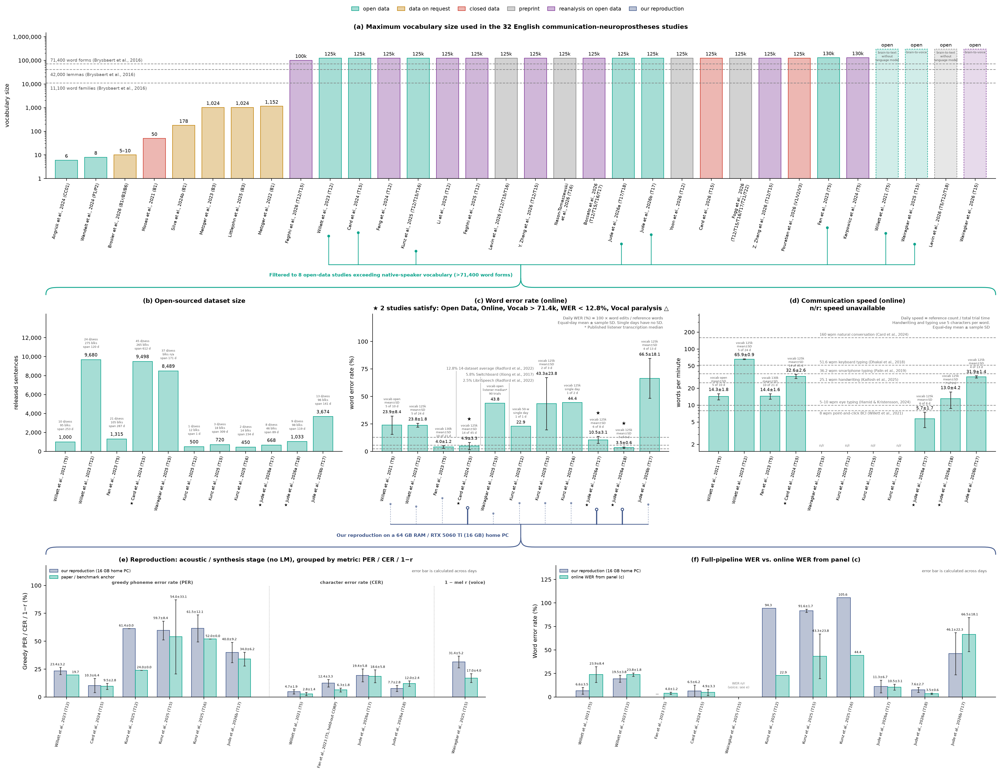

# Communication Neuroprostheses — Consumer-GPU (16 GB VRAM / 64 GB RAM) Reproduction Suite

[](https://github.com/Physics-Lee/communication-neuroprostheses-reproduction/actions/workflows/verify_benchmark.yml)

Reproducing **8 open-data speech, typing, and handwriting neuroprosthesis studies** on a single consumer GPU (**1× NVIDIA GeForce RTX 5060 Ti 16 GB VRAM, 64 GB DDR5 RAM**), with end-to-end training/decoding code, memory-wall mitigations, per-trial decode outputs, and benchmark figure scripts.

> **This work is a product of we-linking.** The reproduction suite, model ports, memory-wall mitigations, and benchmark figures were developed and are maintained by **we-linking**.



- **Vector PDF (TrueType Type-42 embedded)**: [`figures/results/20261124_repository_migration/figure2.pdf`](figures/results/20261124_repository_migration/figure2.pdf)
- **Figure 2(c,d) online WER and speed**: [English notebook](figures/tutorial.ipynb) and [methods, daily data, and corrections](figures/docs/20261124_evaluation_protocol/figure2cd.md).
- **Figure 3 (error rates and memory use)**: [`figures/results/20261124_repository_migration/figure3.png`](figures/results/20261124_repository_migration/figure3.png) ([`.pdf`](figures/results/20261124_repository_migration/figure3.pdf)) — paired held-out-trial WER vs. PER and WER vs. CER by recording session, plus peak host RAM and GPU VRAM. The data come from `figures/results/20261124_repository_migration/session_per_vs_wer.json`, `figures/results/20261124_repository_migration/session_cer_vs_wer.json`, and `figures/reproduction_benchmark.yaml`.
- **Interactive HTML edition (single file, no dependencies)**: [`figures/results/20261124_repository_migration/figure2.html`](figures/results/20261124_repository_migration/figure2.html) ([`index.html`](index.html)) — Interactive vector SVG edition combining Figure 2 (benchmark), Figure 3 (held-out trial error rates by session and memory use), and Figure 6 (discrete `CTC-TLG` and continuous `Brain-to-Voice` decoding), plus a reproduction ledger and filterable study cards.

---

## Overview & Directory Naming Convention (`yyyymmdd_author`)

Each study directory is named by its **official journal issue publication date (`yyyymmdd`) + first author surname**, providing a strict chronological ordering without arbitrary numbering or suffix collisions:

| Study Directory | Publication | Modality & Participant(s) | Dataset DOI | Official vs. Our Memory Wall Mitigation | Acoustic / Synthesis Stage (Ours vs. Paper) | Full-Pipeline WER (Ours vs. Paper) |
|---|---|---|---|---|---|---|
| [`studies/20210512_willett/`](studies/20210512_willett) | Willett et al., *Nature* 593, 249–254 (2021-05-12) | Handwriting (T5) | [`10.5061/dryad.wh70rxwmv`](https://doi.org/10.5061/dryad.wh70rxwmv) | 56 GB → **26.9 GB RAM** (`mmap` fold assembly + lazy Kaldi FST) | Raw CER: **4.71%** vs. 2.78% | **2.21%** vs. 3.45% (bi-gram + GPT-2) |
| [`studies/20230831_willett/`](studies/20230831_willett) | Willett et al., *Nature* 620, 1031–1036 (2023-08-31) | Speech (T12) | [`10.5061/dryad.x69p8czpq`](https://doi.org/10.5061/dryad.x69p8czpq) | 300 GB 5-gram WFST / 80 GB A100 → **1.46 GB KenLM trie** (or 19.6 GB `mmap`) & **13.0 GB VRAM** | Greedy PER: **23.42%** vs. 19.7% | **23.22%** vs. 23.8% (5-gram + OPT-6.7B) |
| [`studies/20231201_fan/`](studies/20231201_fan) | Fan et al., *NeurIPS* 36, 42258–42270 (2023-12) | Handwriting CORP (T5) | [`10.5061/dryad.hqbzkh1p6`](https://doi.org/10.5061/dryad.hqbzkh1p6) | 40 GB rig → **4.0 GB VRAM** (seed RNN + 403-day online pseudo-label adaptation) | Greedy CER **6.20%** (v6 batch), **12.4%** (v7 held out) | Paper online **6.16%**. Released online subset **4.10%** pooled. Matched full-pipeline reproduction WER unverified. |
| [`studies/20240815_card/`](studies/20240815_card) | Card et al., *N. Engl. J. Med.* 391, 609–618 (2024-08-15) | Speech (T15) | [`10.5061/dryad.dncjsxm85`](https://doi.org/10.5061/dryad.dncjsxm85) | 300 GB 5-gram WFST → **19.6 GB RAM** (`mmap` + `.idx`) & **13.0 GB VRAM** | Greedy PER: **10.19%** vs. 9.54% | **7.02%** vs. 3.40% (10-model ens.) |
| [`studies/20250612_wairagkar/`](studies/20250612_wairagkar) | Wairagkar et al., *Nature* 642, 417–424 (2025-06-12) | Voice synthesis (T15) | [`10.5061/dryad.2280gb64f`](https://doi.org/10.5061/dryad.2280gb64f) | 3×24 GB RTX 3090 + A6000 → **1.5 GB VRAM** (causal 40-bin Mel encoder) | Spectral distortion $1-r$: **31.4%** ($r=0.69$) vs. 17.0% ($r=0.83$) | Voice synthesis (acoustic stage only) |
| [`studies/20250821_kunz/`](studies/20250821_kunz) | Kunz et al., *Cell* 188, 4658–4673 (2025-08-21) | Inner & attempted speech (T12, T15, T16) | [`10.5061/dryad.gf1vhhn1j`](https://doi.org/10.5061/dryad.gf1vhhn1j) | 48 GB VRAM / 60 GB WFST → **13.0 GB VRAM** & **1.46 GB KenLM** | Greedy PER: **61.4% / 59.7% / 61.5%** | **122.1% / 79.5% / 95.5%** (sparse 1–3 sess. inner-speech subsets) |
| [`studies/20260316_jude/`](studies/20260316_jude) | Jude et al., *Nat. Neurosci.* 29, 2613–2622 (2026-03-16) | Touch typing (T17, T18) | [`10.5061/dryad.cz8w9gjjk`](https://doi.org/10.5061/dryad.cz8w9gjjk) | 64+ GB RAM → **22.5 GB RAM** (bypass unpruned FST preload) & **11.5 GB VRAM** | Raw CER: **19.4% ± 5.8% (T17, best 8.2%) / 7.7% ± 2.8% (T18, best 2.6%)** | **11.4% ± 6.9% (T17, best 4.6%) / 6.7% ± 3.7% (T18, best 0.0%)** vs. 12.5% / <7% |
| [`studies/20260428_jude/`](studies/20260428_jude) | Jude et al., *Cell Rep.* 45, 117162 (2026-04-28) | Intended speech in LIS (T17) | [`10.5061/dryad.vq83bk481`](https://doi.org/10.5061/dryad.vq83bk481) | 48 GB VRAM / 300 GB WFST → **13.0 GB VRAM** & **19.6 GB RAM** | Greedy PER: **39.97%** vs. 34.0% | **46.47%** vs. ~50% (conversational 125k) |

---

## Conda Environment Setup (`bci-repro`)

All 8 study reproduction pipelines, GPU model ports, rescoring scripts, and figure generators are verified in a unified Conda environment named **`bci-repro`** (**Python 3.11.18, CUDA 12.8**):

```bash
# Option 1: Create directly from environment.yml
conda env create -f environment.yml
conda activate bci-repro

# Option 2: Create via conda + pip requirements.txt
conda create -n bci-repro python=3.11 -y
conda activate bci-repro
pip install -r requirements.txt --extra-index-url https://download.pytorch.org/whl/cu128
```

### Core Verified Package Versions (`bci-repro`)

| Category | Packages & Pinned Versions |
|---|---|
| **Python & Runtime** | `python==3.11.18`, `pip==26.2.2`, `setuptools==78.1.0` |
| **Deep Learning & GPU Training** | `torch==2.11.0+cu128`, `torchvision==0.26.0+cu128`, `torchaudio==2.11.0+cu128`, `tensorflow==2.14.0`, `keras==2.14.0`, `einops==0.8.2` |
| **LLM Second-Pass Rescoring** | `transformers==5.22.1`, `accelerate==1.15.0`, `tokenizers==0.23.3`, `safetensors==0.8.0`, `huggingface_hub==2.4.0` |
| **Scientific Computing & Audio/HDF5 I/O** | `numpy==1.26.4`, `scipy==1.17.1`, `pandas==3.0.6`, `scikit-learn==1.9.1`, `h5py==3.16.0`, `librosa==0.11.0`, `numba==0.68.1`, `soundfile==0.14.0` |
| **Phoneme / CTC / WER Decoding** | `editdistance==0.8.1`, `g2p-en==2.1.0`, `pyctcdecode==0.5.0`, `nltk==3.10.4`, `pygtrie==2.6.2` |
| **Config, Visualization & Notebooks** | `matplotlib==3.11.2`, `PyYAML==6.0.3`, `omegaconf==2.4.0`, `tqdm==4.70.1`, `pymupdf==2.1`, `ipykernel==7.4.0` |

---

## Repository Structure

See the [common file tree](docs/20261124_repository_migration/README.md#repository-layout) for the release, format, and decoder naming rules. The [eight-study naming map](docs/20261124_repository_migration/naming_map.md) lists the public commands, current input paths, and archived result filenames.

For a full run, follow the download and extraction instructions in the study's `tutorial.ipynb`. Set up the pinned upstream code with `python shared/tools/setup_upstream.py`. By default, scripts read inputs from the study directory under `studies/`. To use a separate disk, set `BCI_DATA_ROOT` to a directory containing the same study IDs and input layout. `BCI_ARCHIVE_ROOT` explicitly selects historical checkout names. Set `BCI_RUN_ID` for a new dated results directory when running the study stages that use default output paths.

```text
communication-neuroprostheses-reproduction/
├── studies/                         # Eight study entrances, named by publication date
│   └── yyyymmdd_author/
│       ├── README.md
│       ├── tutorial.ipynb            # Recompute archived results without downloading data
│       ├── code/
│       ├── data/                     # Sources and archived evaluation trial lists
│       ├── results/yyyymmdd_<run>/
│       ├── log/yyyymmdd_<run>/
│       └── docs/yyyymmdd_<topic>/
├── figures/                         # Cross-study inputs, build code, and dated figure bundles
├── shared/                          # Shared decoders and scoring tools
├── tutorials/                       # Cross-study tutorials
├── docs/                            # Dated governance and migration notes
└── index.html                       # Interactive benchmark entry point
```

Every script carries a numpy-style docstring, and each study's `code/` folder has its
own `README.md` code guide listing every file's role and the pipeline order — start
there (e.g. [`studies/20210512_willett/code/README.md`](studies/20210512_willett/code/README.md)).

---

## Interactive Tutorials (`tutorials/`) & AI Agent Guides (`AGENTS.md`)

New to intracortical BCIs or exploring with an AI coding agent (**ZCode / Claude Code / Cursor**)?

- **For Students ([`tutorials/`](tutorials))** — 3 pre-rendered, **zero-download** Jupyter Notebooks in **English** (with Chinese companion versions in [`tutorials/zh/`](tutorials/zh)) that run out-of-the-box in `bci-repro`:
  1. [`01_zero_download_results_playground.ipynb`](tutorials/01_zero_download_results_playground.ipynb) ([中文版](tutorials/zh/01_zero_download_results_playground_zh.ipynb)): Inspect archived per-trial decode outputs across all 8 studies, compare **3-gram KenLM → 125k 5-gram WFST → OPT-6.7B → Qwen3-8B** sentence corrections side-by-side, re-plot the **26% PER language-model phase transition**, and visualize 403-day CORP online recalibration.
  2. [`02_memory_wall_autopsy_16gb_gpu.ipynb`](tutorials/02_memory_wall_autopsy_16gb_gpu.ipynb) ([中文版](tutorials/zh/02_memory_wall_autopsy_16gb_gpu_zh.ipynb)): Hands-on benchmarks showing how `numpy.memmap` + `.idx` state tables and BF16 single-layer cuDNN GRU stacks compress **300 GB RAM & 80 GB VRAM** requirements into **19.6 GB RAM & 13.0 GB VRAM** on a single RTX 5060 Ti (8.1× faster step time, 36% lower VRAM).
  3. [`03_single_session_end_to_end_demo.ipynb`](tutorials/03_single_session_end_to_end_demo.ipynb) ([中文版](tutorials/zh/03_single_session_end_to_end_demo_zh.ipynb)): Train a **41-class ARPAbet phoneme** speech BCI decoder (`39 phonemes + SIL + CTC <blank>`) from scratch on GPU, prove **zero-overlap compositional generalization on strictly unseen test sentences** (`PER: 95.6% → 0.0%`), visualize frame-level phoneme posteriors, and run Viterbi pronunciation-lexicon word decoding (`PER → 0.0% WER`).
- **For AI Agents ([`AGENTS.md`](AGENTS.md))** — Root and per-directory `AGENTS.md` files document exact tensor shapes, memory-wall guardrails, read-only benchmark artifacts, and entrypoints so your AI collaborator can run ablations safely on a consumer PC without triggering OOM.

---

## Figure 3 evaluation splits

Each open marker pools matched evaluation trials within a recording session. Greedy PER or CER divides the summed phoneme or character edit counts by the corresponding reference counts. WER uses the word edits from decoding the same trials with an LM. The evaluation recordings include sessions that also contributed separate training or calibration trials. Several splits served as validation for checkpoint selection, so the plots describe performance on those evaluation splits.

| Panel | Study | Figure 3 evaluation trials per session | Fig. 2(c) online days | Fig. 3 days | Fig. 3 trials |
|---|---|---|---:|---:|---:|
| 3(a) | Willett 2023 (T12) | Released labeled test partition, used as validation | 5 | 24 | 880 |
| 3(a) | Card 2024 (T15) | Released validation partition from the P4 GRU run | 14 | 41 | 1,426 |
| 3(a) | Jude 2026b (T17) | Last eligible sentence block, used as validation | 4 | 12 | 417 |
| 3(b) | Willett 2021 (T5) | Released `HeldOutTrials` indices, with bigram 1-best WER | 5 | 10 | 63 |
| 3(b) | Fan 2023 (T5) | Final six trials withheld from adaptation, decoded with a character 5-gram | 10 | 10 | 60 |
| 3(b) | Jude 2026a (T17) | Released test trials, used as validation | 6 | 8 | 134 |
| 3(b) | Jude 2026a (T18) | Released test trials, used as validation, with the one-trial session excluded | 7 | 7 | 140 |

For each study arm listed, its Figure 2(c) dates are included in Figure 3. Figure 2(c) scores selected blocks from the authors' real-time outputs. Figure 3 scores the offline reproduction on the evaluation split. Even when the dates match, the scored trials can differ. For example, Willett 2023 has 400 online trials in Figure 2(c), of which 200 have a matched offline output in Figure 3(a). The [paired trial and day tables](figures/docs/20261124_evaluation_protocol/figure2cd.md#paired-online-and-offline-wer) identify the overlap.

Figure 2 uses study-level comparisons with its own aggregation and run choices. Card's pooled P4 GRU PER appears in Figures 2(e) and 3(a), and its BiGRU WER appears in Figure 2(f). For Fan, Figure 2(e) reports the mean and standard deviation across held-out replay days alongside the paper's online raw CER. Figure 2(f) shows the online WER from panel (c) with an empty reproduction slot. The held-out character-LM replay in Figure 3(b) uses a different decoder from the paper's full pipeline.

## Quick Verification

See the [figure guide](figures/README.md) for the current release and traceable inputs.

The builders read archived evaluation outputs from the study `results/` directories and regenerate both session tables.

```bash
conda activate bci-repro
python figures/code/build_session_per_vs_wer.py
python figures/code/build_session_cer_vs_wer.py
python shared/tools/wer_from_tsv.py --no-sidecar studies/20230831_willett/results/20261124_import_btot24/wl_5g_opt_official.tsv
python figures/code/render_figure2.py
python figures/code/render_figure3.py
```

---

## Companion Repository

- **Weekly-Updated Living Timeline**: [`Physics-Lee/communication-neuroprostheses-timeline`](https://github.com/Physics-Lee/communication-neuroprostheses-timeline)

## License & Attribution

This work is a product of **we-linking** and is released under the [PolyForm Noncommercial License 1.0.0](LICENSE) ([SPDX: `PolyForm-Noncommercial-1.0.0`](https://spdx.org/licenses/PolyForm-Noncommercial-1.0.0.html)):

- ✅ **Allowed**: any **noncommercial** purpose — academic research, teaching, and personal study; use by educational institutions, public research organizations, and other noncommercial organizations is explicitly permitted, regardless of funding source.
- ❌ **Prohibited**: any **commercial** use of this repository, in whole or in part — including sale, product integration, or paid services — unless we-linking grants a separate commercial license.

Official upstream repositories remain under their respective authors' licenses and are referenced (not redistributed) in each study directory.
