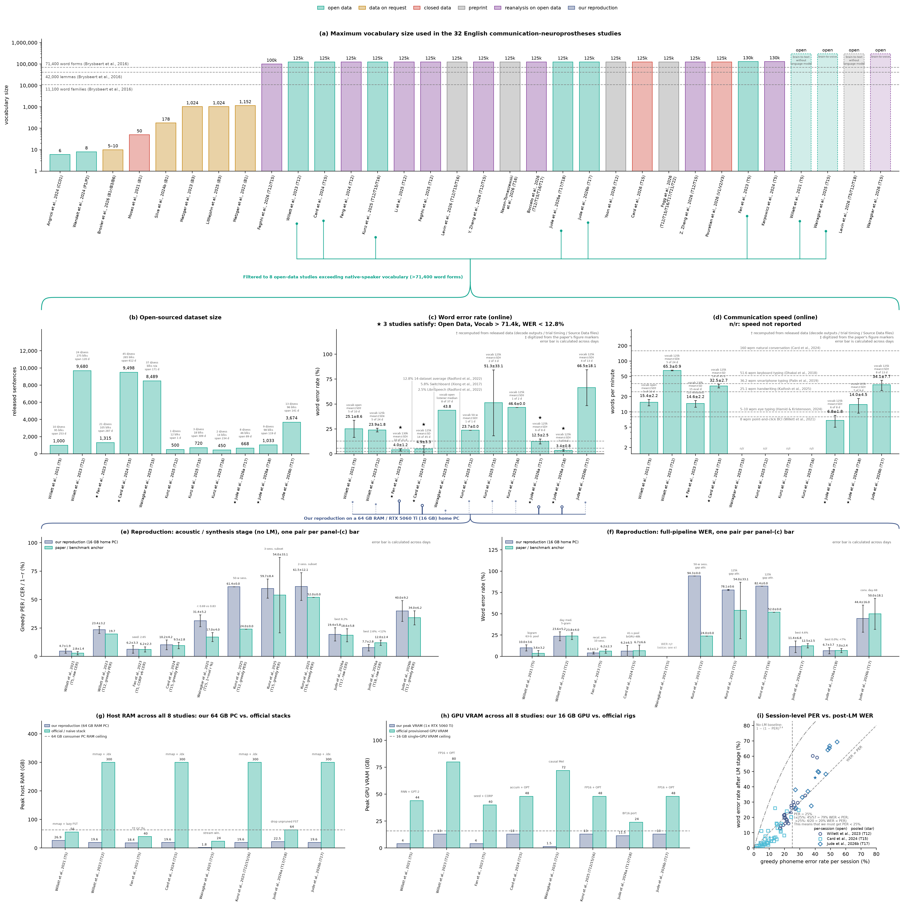

# Communication Neuroprostheses — Consumer-GPU (16 GB VRAM / 64 GB RAM) Reproduction Suite

[](https://github.com/Physics-Lee/communication-neuroprostheses-reproduction/actions/workflows/verify_benchmark.yml)

Reproducing **8 open-data speech, typing, and handwriting neuroprosthesis studies** on a single consumer GPU (**1× NVIDIA GeForce RTX 5060 Ti 16 GB VRAM, 64 GB DDR5 RAM**), with end-to-end training/decoding code, memory-wall mitigations, per-trial decode outputs, and benchmark figure scripts.



- **Vector PDF (TrueType Type-42 embedded)**: [`communication_neuroprostheses_reproduction.pdf`](communication_neuroprostheses_reproduction.pdf)
- **Interactive HTML edition (single file, no dependencies)**: [`communication_neuroprostheses_reproduction.html`](communication_neuroprostheses_reproduction.html) ([`index.html`](index.html)) — Interactive vector SVG edition combining **Figure 2** (Panels a–i: 32-study vocabulary funnel, open-sourced dataset size, online WER, online speed, consumer-GPU acoustic & full-pipeline WER reproductions, Host RAM & GPU VRAM walls, and the 77-session `PER = 25%` phase diagram) and **Figure 6** (Panels a–d: discrete `CTC-TLG` vs. continuous `Brain-to-Voice` decoding cascades and their global linguistic applicability across ~7,000 spoken languages, highlighting the three limits of `CTC-TLG`), plus an interactive 8-study reproduction ledger, selected-study spotlight, and filterable study cards.

---

## Overview & Directory Naming Convention (`yyyymmdd_author`)

Each study directory is named by its **official journal issue publication date (`yyyymmdd`) + first author surname**, providing a strict chronological ordering without arbitrary numbering or suffix collisions:

| Study Directory | Publication | Modality & Participant(s) | Dataset DOI | Official vs. Our Memory Wall Mitigation | Acoustic / Synthesis Stage (Ours vs. Paper) | Full-Pipeline WER (Ours vs. Paper) |
|---|---|---|---|---|---|---|
| [`20210512_willett/`](20210512_willett/) | Willett et al., *Nature* 593, 249–254 (2021-05-12) | Handwriting (T5) | [`10.5061/dryad.wh70rxwmv`](https://doi.org/10.5061/dryad.wh70rxwmv) | 56 GB → **26.9 GB RAM** (`mmap` fold assembly + lazy Kaldi FST) | Raw CER: **4.71%** vs. 2.78% | **2.21%** vs. 3.45% (bi-gram + GPT-2) |
| [`20230831_willett/`](20230831_willett/) | Willett et al., *Nature* 620, 1031–1036 (2023-08-31) | Speech (T12) | [`10.5061/dryad.x69p8czpq`](https://doi.org/10.5061/dryad.x69p8czpq) | 300 GB 5-gram WFST / 80 GB A100 → **1.46 GB KenLM trie** (or 19.6 GB `mmap`) & **13.0 GB VRAM** | Greedy PER: **23.42%** vs. 19.7% | **23.22%** vs. 23.8% (5-gram + OPT-6.7B) |
| [`20231201_fan/`](20231201_fan/) | Fan et al., *NeurIPS* 36, 42258–42270 (2023-12) | Handwriting CORP (T5) | [`10.5061/dryad.hqbzkh1p6`](https://doi.org/10.5061/dryad.hqbzkh1p6) | 40 GB rig → **4.0 GB VRAM** (seed RNN + 403-day online pseudo-label adaptation) | CORP v6 CER: **6.20%** vs. 6.16% | **6.10%** vs. 6.20% (bi-gram + GPT-2) |
| [`20240815_card/`](20240815_card/) | Card et al., *N. Engl. J. Med.* 391, 609–618 (2024-08-15) | Speech (T15) | [`10.5061/dryad.dncjsxm85`](https://doi.org/10.5061/dryad.dncjsxm85) | 300 GB 5-gram WFST → **19.6 GB RAM** (`mmap` + `.idx`) & **13.0 GB VRAM** | Greedy PER: **10.19%** vs. 9.54% | **7.02%** vs. 3.40% (10-model ens.) |
| [`20250612_wairagkar/`](20250612_wairagkar/) | Wairagkar et al., *Nature* 642, 417–424 (2025-06-12) | Voice synthesis (T15) | [`10.5061/dryad.2280gb64f`](https://doi.org/10.5061/dryad.2280gb64f) | 3×24 GB RTX 3090 + A6000 → **1.5 GB VRAM** (causal 40-bin Mel encoder) | Spectral distortion $1-r$: **31.4%** ($r=0.69$) vs. 17.0% ($r=0.83$) | Voice synthesis (acoustic stage only) |
| [`20250821_kunz/`](20250821_kunz/) | Kunz et al., *Cell* 188, 4658–4673 (2025-08-21) | Inner & attempted speech (T12, T15, T16) | [`10.5061/dryad.gf1vhhn1j`](https://doi.org/10.5061/dryad.gf1vhhn1j) | 48 GB VRAM / 60 GB WFST → **13.0 GB VRAM** & **1.46 GB KenLM** | Greedy PER: **61.4% / 59.7% / 61.5%** | **122.1% / 79.5% / 95.5%** (sparse 1–3 sess. inner-speech subsets) |
| [`20260316_jude/`](20260316_jude/) | Jude et al., *Nat. Neurosci.* 29, 2613–2622 (2026-03-16) | Touch typing (T17, T18) | [`10.5061/dryad.cz8w9gjjk`](https://doi.org/10.5061/dryad.cz8w9gjjk) | 64+ GB RAM → **22.5 GB RAM** (bypass unpruned FST preload) & **11.5 GB VRAM** | Raw CER: **19.4% ± 5.8% (T17, best 8.2%) / 7.7% ± 2.8% (T18, best 2.6%)** | **11.4% ± 6.9% (T17, best 4.6%) / 6.7% ± 3.7% (T18, best 0.0%)** vs. 12.5% / <7% |
| [`20260428_jude/`](20260428_jude/) | Jude et al., *Cell Rep.* 45, 117162 (2026-04-28) | Intended speech in LIS (T17) | [`10.5061/dryad.vq83bk481`](https://doi.org/10.5061/dryad.vq83bk481) | 48 GB VRAM / 300 GB WFST → **13.0 GB VRAM** & **19.6 GB RAM** | Greedy PER: **39.97%** vs. 34.0% | **46.47%** vs. ~50% (conversational 125k) |

---

## Conda Environment Setup (`bci-repro`)

All 8 study reproduction pipelines, GPU model ports, rescoring scripts, and figure generators are verified in a unified Conda environment named **`bci-repro`** (**Python 3.11.18, CUDA 12.8**):

```bash
# Option 1: Create directly from environment.yml
conda env create -f environment.yml
conda activate bci-repro

# Option 2: Create via conda + pip requirements.txt
conda create -n bci-repro python=3.11 -y
conda activate bci-repro
pip install -r requirements.txt --extra-index-url https://download.pytorch.org/whl/cu128
```

### Core Verified Package Versions (`bci-repro`)

| Category | Packages & Pinned Versions |
|---|---|
| **Python & Runtime** | `python==3.11.18`, `pip==26.2.2`, `setuptools==78.1.0` |
| **Deep Learning & GPU Training** | `torch==2.11.0+cu128`, `torchvision==0.26.0+cu128`, `torchaudio==2.11.0+cu128`, `tensorflow==2.14.0`, `keras==2.14.0`, `einops==0.8.2` |
| **LLM Second-Pass Rescoring** | `transformers==5.22.1`, `accelerate==1.15.0`, `tokenizers==0.23.3`, `safetensors==0.8.0`, `huggingface_hub==2.4.0` |
| **Scientific Computing & Audio/HDF5 I/O** | `numpy==1.26.4`, `scipy==1.17.1`, `pandas==3.0.6`, `scikit-learn==1.9.1`, `h5py==3.16.0`, `librosa==0.11.0`, `numba==0.68.1`, `soundfile==0.14.0` |
| **Phoneme / CTC / WER Decoding** | `editdistance==0.8.1`, `g2p-en==2.1.0`, `pyctcdecode==0.5.0`, `nltk==3.10.4`, `pygtrie==2.6.2` |
| **Config, Visualization & Notebooks** | `matplotlib==3.11.2`, `PyYAML==6.0.3`, `omegaconf==2.4.0`, `tqdm==4.70.1`, `pymupdf==2.1`, `ipykernel==7.4.0` |

---

## Repository Structure

```text
communication-neuroprostheses-reproduction/
├── 20210512_willett/                     # Willett et al., 2021 (Nature, handwriting T5)
├── 20230831_willett/                     # Willett et al., 2023 (Nature, speech T12)
├── 20231201_fan/                         # Fan et al., 2023 (NeurIPS, 403-day handwriting CORP T5)
├── 20240815_card/                        # Card et al., 2024 (NEJM, speech & rapid calibration T15)
├── 20250612_wairagkar/                   # Wairagkar et al., 2025 (Nature, voice synthesis T15)
├── 20250821_kunz/                        # Kunz et al., 2025 (Cell, inner speech T12/T15/T16)
├── 20260316_jude/                        # Jude et al., 2026a (Nat. Neurosci., touch typing T17/T18)
├── 20260428_jude/                        # Jude et al., 2026b (Cell Rep., intended speech in LIS T17)
├── shared/                               # Shared C++ TLG/WeNet decoders, KenLM/OPT/Qwen rescorers, plots
├── tutorials/                            # 3 zero-download interactive Jupyter Notebooks for students
├── docs/CLEANUP_AUDIT.md                 # Per-file audit: what was deleted and why (2026-11-08 cleanup)
├── AGENTS.md                             # Root + per-directory AI Agent collaboration guides (ZCode / Claude Code)
├── environment.yml                       # Full Conda environment specification (name: bci-repro)
├── requirements.txt                      # Full pinned pip package list for bci-repro
├── reproduction_benchmark.yaml           # Structured dataset for the benchmark overview figure (panels a–h)
├── reproduction_benchmark.json           # Auto-synced JSON mirror of reproduction_benchmark.yaml
├── session_per_vs_wer.json               # Session-level (PER, post-LM WER) pairs for panel (i)
├── build_session_per_vs_wer.py           # Recomputes session_per_vs_wer.json from per-trial decode TSVs
├── communication_neuroprostheses_reproduction.html # Interactive HTML edition (Figure 2 + Figure 6: Limit of CTC-TLG)
└── render_figure2.py                     # Standalone renderer + overlap verifier for .png, .pdf, and .html
```

Every script carries a numpy-style docstring, and each study's `code/` folder has its
own `README.md` code guide listing every file's role and the pipeline order — start
there (e.g. [`20210512_willett/code/README.md`](20210512_willett/code/README.md)).

---

## Interactive Tutorials (`tutorials/`) & AI Agent Guides (`AGENTS.md`)

New to intracortical BCIs or exploring with an AI coding agent (**ZCode / Claude Code / Cursor**)?

- **For Students ([`tutorials/`](tutorials/))** — 3 pre-rendered, **zero-download** Jupyter Notebooks in **English** (with Chinese companion versions in [`tutorials/zh/`](tutorials/zh/)) that run out-of-the-box in `bci-repro`:
  1. [`01_zero_download_results_playground.ipynb`](tutorials/01_zero_download_results_playground.ipynb) ([中文版](tutorials/zh/01_zero_download_results_playground_zh.ipynb)): Inspect archived per-trial decode outputs across all 8 studies, compare **3-gram KenLM → 125k 5-gram WFST → OPT-6.7B → Qwen3-8B** sentence corrections side-by-side, re-plot the **26% PER language-model phase transition**, and visualize 403-day CORP online recalibration.
  2. [`02_memory_wall_autopsy_16gb_gpu.ipynb`](tutorials/02_memory_wall_autopsy_16gb_gpu.ipynb) ([中文版](tutorials/zh/02_memory_wall_autopsy_16gb_gpu_zh.ipynb)): Hands-on benchmarks showing how `numpy.memmap` + `.idx` state tables and BF16 single-layer cuDNN GRU stacks compress **300 GB RAM & 80 GB VRAM** requirements into **19.6 GB RAM & 13.0 GB VRAM** on a single RTX 5060 Ti (8.1× faster step time, 36% lower VRAM).
  3. [`03_single_session_end_to_end_demo.ipynb`](tutorials/03_single_session_end_to_end_demo.ipynb) ([中文版](tutorials/zh/03_single_session_end_to_end_demo_zh.ipynb)): Train a **41-class ARPAbet phoneme** speech BCI decoder (`39 phonemes + SIL + CTC <blank>`) from scratch on GPU, prove **zero-overlap compositional generalization on strictly unseen test sentences** (`PER: 95.6% → 0.0%`), visualize frame-level phoneme posteriors, and run Viterbi pronunciation-lexicon word decoding (`PER → 0.0% WER`).
- **For AI Agents ([`AGENTS.md`](AGENTS.md))** — Root and per-directory `AGENTS.md` files document exact tensor shapes, memory-wall guardrails, read-only benchmark artifacts, and entrypoints so your AI collaborator can run ablations safely on a consumer PC without triggering OOM.

---

## Quick Verification

All per-trial decode outputs (`*.tsv`, `*.csv`, `*.json`) produced by our single-GPU runs are archived inside each study's `results/` directory. Anyone can recompute the session-level phase diagram (`session_per_vs_wer.json`), verify WERs, and regenerate the benchmark overview figure in seconds:

```bash
conda activate bci-repro
python build_session_per_vs_wer.py
python shared/tools/wer_from_tsv.py 20230831_willett/results/decode_outputs/wl_5g_opt_official.tsv
python render_figure2.py
```

---

## Companion Repository

- **Weekly-Updated Living Timeline**: [`Physics-Lee/communication-neuroprostheses-timeline`](https://github.com/Physics-Lee/communication-neuroprostheses-timeline)

## License

Released under the [MIT License](LICENSE). Official upstream repositories remain under their respective authors' licenses and are referenced (not redistributed) in each study directory.
